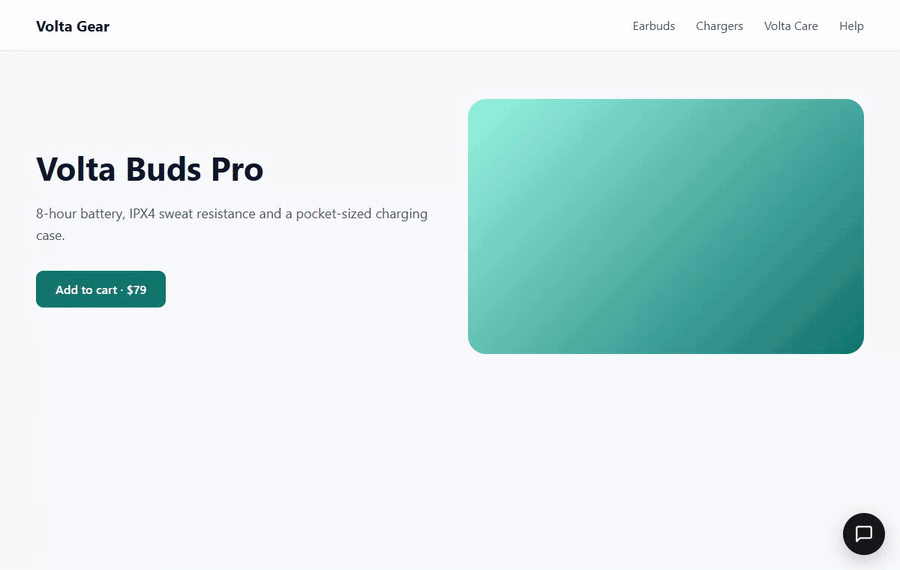
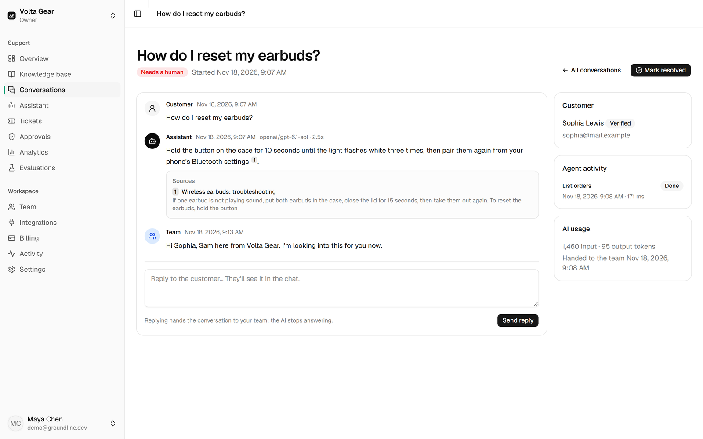
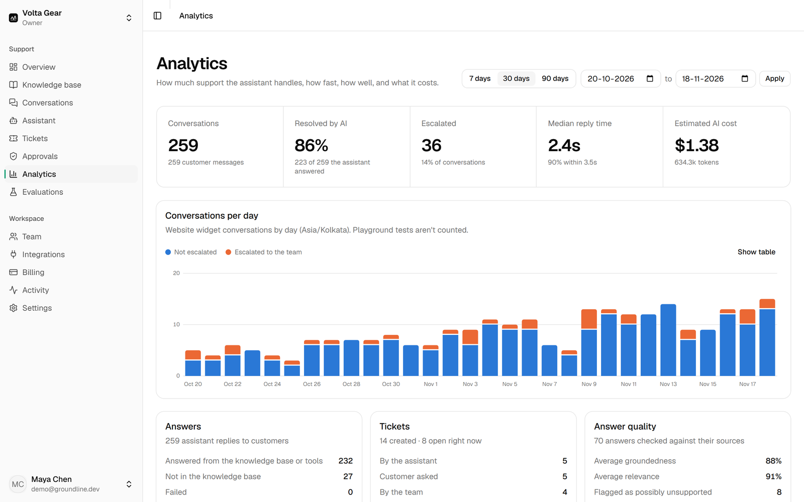
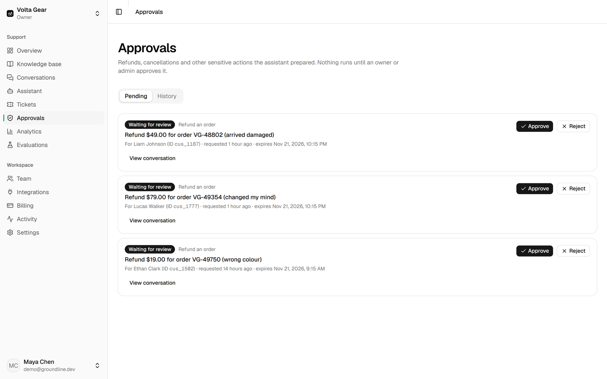
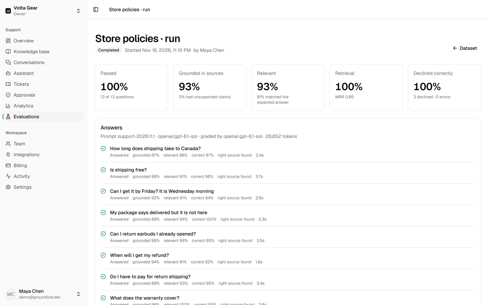
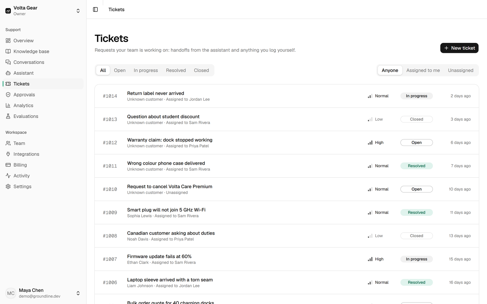
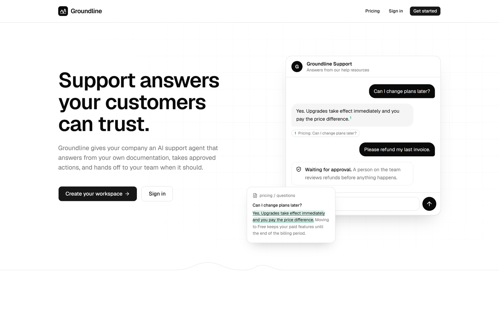
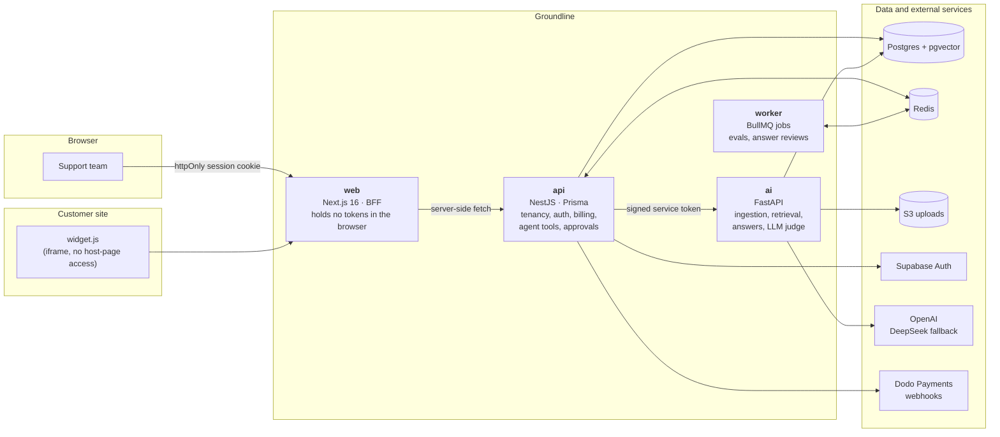
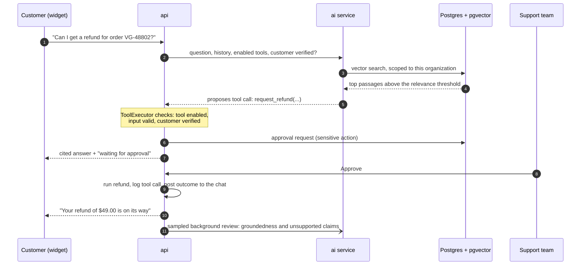
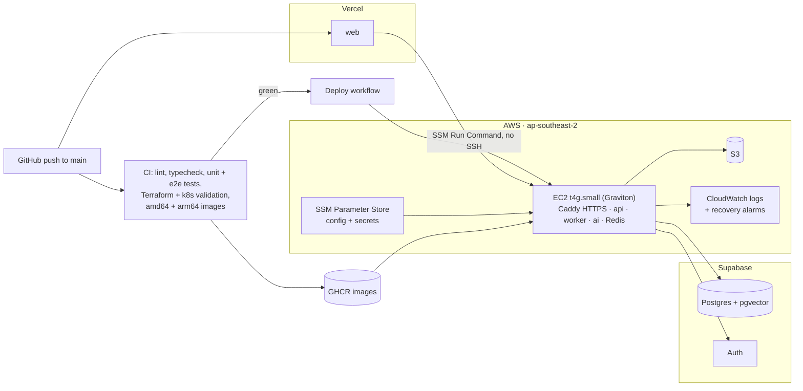

<div align="center">

# Groundline

**AI customer support that answers only from your own documentation, takes actions with human approval, and hands off to your team when it should.**

[](https://github.com/Navraj86/groundline/actions/workflows/ci.yml)


[**Live app**](https://groundline-lemon.vercel.app) · [Architecture](#architecture) · [Engineering highlights](#engineering-highlights) · [Run it locally](#run-it-locally) · [Full reference](docs/reference.md)



<sub>A live answer from the embeddable widget: retrieved from the company's knowledge base, cited, and checked for unsupported claims.</sub>

</div>

## What it is

Groundline is a multi-tenant SaaS. A company signs up, adds its help articles, PDFs and web
pages, and pastes one `<script>` tag on its site. Its customers then get an assistant that:

- **Answers only from that company's knowledge** and cites the passage behind every claim. When
  nothing relevant is found, it says so and offers a person instead of guessing.
- **Acts on the customer's account** (order lookups, subscriptions, tickets) once the customer is
  verified, while **refunds and cancellations wait for a human to approve them**.
- **Hands off to the team** with the full conversation, sources and tool history in a shared
  inbox and ticket queue.

The support team gets analytics, cost tracking, hallucination monitoring and an evaluation
suite to measure answer quality before and after every prompt or model change.

## Screens

| | |
| --- | --- |
|  |  |
| **Inbox.** Every answer shows its sources, the model used, the tools the agent ran and the token cost. | **Analytics.** AI resolution rate, escalations, reply times, ticket flow and cost per model. |
|  |  |
| **Human approval.** The agent prepares refunds and cancellations; only owners and admins can run them. | **Evaluations.** Test sets scored for groundedness, correctness, retrieval (hit rate, MRR) and safe declines. |
|  |  |
| **Tickets.** Raised by the assistant, the customer or the team, numbered per workspace, with history and internal notes. | **Self-serve sign-up.** Plans, checkout and limits are enforced from billing webhooks. |

<sub>Screens are from the demo workspace that `pnpm --filter @groundline/api demo:seed` creates: a fictional electronics store with 30 days of history.</sub>

## Architecture



| Service | Responsibility |
| --- | --- |
| [`apps/web`](apps/web) | Next.js App Router: marketing site, auth flows, workspace dashboard, widget iframe. Calls the API only from the server. |
| [`apps/api`](apps/api) | NestJS system of record: organizations, roles, invitations, billing, conversations, tickets, the agent's tool executor, approvals, analytics, evaluations, audit log. Also runs the background workers. |
| [`apps/ai`](apps/ai) | FastAPI: document ingestion worker, pgvector retrieval, grounded answers with tool calling, the answer-review judge. |
| [`packages/shared`](packages/shared) | Roles, permissions, zod schemas and API types used by both web and API. |

### How a customer question is answered



## Engineering highlights

**Grounded answers, not guesses.** Retrieval is scoped by tenant and filtered by relevance. With
nothing relevant, the model is never called. Sources are passed as fenced, numbered data, so
instructions inside a document are ignored. Answers cite `[n]`, and the model replies
`NO_ANSWER` rather than inventing one.

**The model proposes, the server decides.** The AI service only suggests tool calls. The API's
`ToolExecutor` runs a call only if the tool is enabled, its input validates and, for account
tools, the customer was verified with a JWT signed by the company's own backend. Refunds and
cancellations become approval requests that expire after 72 hours. Every call is logged with
its input, output and timing.

**Measured quality.** A sample of live answers is re-checked by an LLM judge against the full
text of the sources they cited, and low scores are flagged in the inbox and analytics.
Evaluation datasets score pass rate, groundedness, correctness, retrieval hit rate and MRR, and
decline accuracy, with a built-in guardrails set (prompt injection, off-topic, other customers'
data). Runs are kept per prompt version and model, so regressions are visible.

**Multi-tenancy you can't probe.** Every organization route passes `OrgAccessGuard`, which
resolves membership and checks a permission from the shared role map. Non-members get `404`,
not `403`. Administrative changes are written to an audit log in the same transaction.

**Security by default.**
- The browser never holds an access token: the web app keeps sessions in httpOnly cookies and
  calls the API from the server.
- Invitation tokens are stored only as SHA-256 hashes.
- Connector secrets are encrypted with AES-256-GCM.
- Website imports are checked hop by hop against private addresses (SSRF).
- Outbound calls to the company's own backend are HMAC-signed.

**Reliable money and queues.**
- Subscription state changes only through verified, idempotent Dodo Payments webhooks, and
  out-of-order events are skipped.
- Document ingestion uses Postgres as a queue: `FOR UPDATE SKIP LOCKED`, woken by `NOTIFY`,
  with retry and backoff.
- Evaluations and reviews run on BullMQ and resume after a crash.

**Provider fallback.** Answers go to OpenAI and fall back to DeepSeek on outages or rate
limits. Each reply records its provider, model, tokens and latency, which feed the cost
analytics.

## Tech stack

| Layer | Choices |
| --- | --- |
| Frontend | Next.js 16 (App Router, server components, BFF), React, Tailwind CSS, shadcn/ui |
| Backend | NestJS, Prisma 7, zod, BullMQ, Redis |
| AI | Python 3, FastAPI, OpenAI Responses API with DeepSeek fallback, pgvector (HNSW), LLM-as-judge |
| Data and auth | PostgreSQL 17 + pgvector, Supabase Auth (HS256 or JWKS / ES256), S3 |
| Payments | Dodo Payments (hosted checkout, signed webhooks) |
| Tooling | pnpm workspaces, Turborepo, Vitest, Supertest, pytest, oxlint, ESLint, Ruff |
| Delivery | Docker (multi-arch), GitHub Actions, GHCR, Terraform, Kustomize |

## Deployment

The live instance runs for under US$20 a month: managed free tiers where they're good
enough, and AWS for the backend.



- **Default:** Vercel for the web app, Supabase for Postgres and auth, and one Graviton instance
  running Docker Compose behind Caddy. Every green build on `main` deploys automatically
  through SSM, with an automatic rollback if the API doesn't come up.
  Guides: [AWS console](docs/deploy-aws.md) or [Terraform](docs/deploy-aws-terraform.md).
- **Scale-up path:** the same images on ECS Fargate with RDS, ElastiCache and a load balancer
  ([guide](docs/deploy-aws-ecs.md)).
- **Kubernetes:** `kubectl apply -k deploy/k8s` against any cluster.

## Quality

- **Tests:**
  - TypeScript: 32 unit tests (Vitest) and 26 API end-to-end tests (Supertest, against real
    Postgres and Redis).
  - Python: 32 tests (pytest).
- **CI on every push:** lint, typecheck, tests, Terraform validation for both AWS stacks,
  Kubernetes manifest validation, and native amd64 + arm64 image builds.
- **Answer quality:** evaluation runs and sampled reviews of live answers inside the product.

## Run it locally

Requirements: Node.js 24+, pnpm 10, Docker and [uv](https://docs.astral.sh/uv/).

```bash
pnpm install
cp .env.example .env              # set SUPABASE_JWT_SECRET, AUTH_DB_PASSWORD and an AI key
pnpm infra:up                     # Postgres, Redis, Supabase Auth, Mailpit, S3-compatible storage
pnpm db:migrate && pnpm --filter @groundline/api db:seed
pnpm dev                          # web :3000 · api :4000 · ai :8000
```

Then, in a second terminal, load the demo workspace shown in the screenshots:

```bash
pnpm --filter @groundline/api demo:seed
```

Sign in at http://localhost:3000 as `demo@groundline.dev` / `groundline-demo`. No OpenAI key?
Set `EMBEDDINGS_PROVIDER=fake` for word-matching search and use `DEEPSEEK_API_KEY` for answers.

## Repository layout

```
apps/
  web/          Next.js frontend and widget iframe
  api/          NestJS API, workers, Prisma schema and migrations
  ai/           FastAPI AI service (ingestion, retrieval, answers, judge)
packages/
  shared/       Roles, permissions, schemas and types shared by web and API
deploy/
  aws-ec2/      Low-cost AWS setup (console guide files, Terraform, Compose stack)
  aws-ecs/      Scale-up AWS setup (ECS Fargate, RDS, ElastiCache, ALB)
  k8s/          Kustomize manifests
docs/           Requirements, reference and deployment guides
```

## Further reading

- [Reference](docs/reference.md): design decisions, every feature, billing setup, API endpoints
- [Business requirements](docs/requirements.md): the product brief this was built against
- Deployment guides: [AWS console](docs/deploy-aws.md) · [Terraform](docs/deploy-aws-terraform.md) · [ECS Fargate](docs/deploy-aws-ecs.md)
